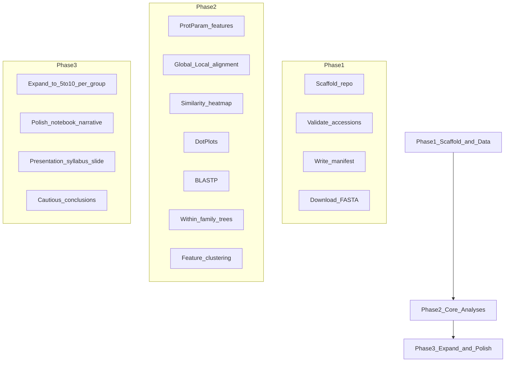

# Luciferase convergent evolution

**Goal:** Test whether independently evolved luciferases share protein-sequence or physicochemical features, as an undergraduate course project.

**Status:** Complete. Results and conclusions are in `docs/PROJECT_REPORT.md`.

## Next

- [ ] Optional follow-up: compare 3D structures (e.g. AlphaFold) for active-site convergence
- [ ] Optional: rename the folder to lowercase-with-dashes (`bio-proj`)


## Done

- [x] Dataset: 51 luciferases in 7 families plus 7 controls (`data/`)
- [x] BLAST+ 2.17.0 installed locally
- [x] Protein properties (`src/features.py`, `results/features.csv`)
- [x] M1 Pairwise similarity: NW/SW alignment, identity heatmap (`src/align.py`)
- [x] M2 Dot plots (`src/dotplot.py`)
- [x] M3 Local BLAST all-vs-all (`src/blast.py`)
- [x] M4 Within-family trees (`src/phylo.py`)
- [x] M5 Clustering and statistics (`src/analysis.py`)
- [x] M6 Analysis notebook (`notebooks/01_analysis.ipynb`) — executes end to end
- [x] M7 Conclusions in `docs/PROJECT_REPORT.md`
- [x] Workspace layout: `PLAN.md`, `CLAUDE.md`, notes in `docs/`

## Decisions

- Protein-level comparison, not DNA.
- One non-luminous control per original family; the 3 added families have none.
- Composition features, not length or weight, are used for cross-family comparison.
- No tree that mixes families; within-family trees only.

---

# Detailed plan (original)


## 1. Project identity

| Item | Decision |
|---|---|
| Full title | Molecular Signatures of Convergent Evolution: Comparative Sequence Analysis of Independently Evolved Luciferases |
| Question | Do independently evolved luciferases share common sequence-level or physicochemical characteristics despite different evolutionary origins? |
| Type | Undergraduate CS elective project/presentation — not a publication |
| Core method | Protein-sequence comparative analysis in Python (not DNA motifs, not ML, not wet lab) |
| Proposal | Already exists — do not rewrite; use as scope contract |
| Source of truth | [docs/bioinformatics_project_handoff.md](docs/bioinformatics_project_handoff.md) |

**Plain-language pitch:** Compare luciferase proteins from fireflies, marine animals (*Renilla*), luminous bacteria, and fungi using public sequences, alignments, BLAST, DotPlots, within-family trees, and measurable protein properties to see what is shared vs family-specific.

## 2. Biological groups and data

**Luciferase groups (target ~5–10 sequences each where public data allow):**
1. Firefly luciferase
2. *Renilla*-type (HLD-derived) luciferase
3. Bacterial LuxA (alpha subunit)
4. Fungal Luz luciferase
5. Copepod secreted luciferase (added 2026-11-03)
6. Dinoflagellate luciferase (added 2026-11-03)
7. Ostracod (cypridinid) luciferase (added 2026-11-03)

Groups 5–7 add independent origins. The convergence question is answered
across families, so more families strengthen it more than more sequences
per family do. The comparison is at the **protein** level (sequence +
physicochemical), not DNA.

**Current dataset (expanded and validated 2026-11-03; full rules in [data/README.md](data/README.md)):**

| Family | Luciferases | Non-luminous controls |
|---|---|---|
| Firefly | 8 | AbLL (A9ZPM4, non-luminous click beetle), CG6178 (Q9VCC6) |
| Renilla-type (HLD-derived) | 3: 2 *Renilla* + brittle-star AfLuc (all characterised ones that exist publicly) | LinB (D4Z2G1), DhaA (P0A3G2), brittle-star DafA (XRP75329.1) |
| Bacterial LuxA | 10 | SsuD (P80645) |
| Fungal Luz | 9 | *Fistulina hepatica* Luz-domain protein (A0A0D7AKP7) |
| Copepod | 10 (3 copepod families) | none known |
| Dinoflagellate | 8 | none known |
| Ostracod | 3 (all that exist publicly) | none known |

The accession list lives in `data/seeds.csv` (UniProt plus 5 NCBI records).
DhlA (P22643) was replaced by the closer dehalogenases LinB and DhaA.

**Download pattern:** `https://rest.uniprot.org/uniprotkb/{ACCESSION}.fasta`

**Scope decisions (confirmed 2026-11-03):**

- Scope goes beyond the proposal: the plan's syllabus analyses (DotPlots,
  within-family trees, feature clustering) are in scope.
- Each of the original four families has its own non-luminous control from
  the same protein family. This makes possible the core test: does each
  luciferase family differ from its own control in the same direction? The
  three added families have no known non-luminous homologs. They join the
  cross-family feature comparison only.
- Dataset rules: complete sequences only; reviewed entries preferred; within a
  family, luciferases must be <97% identical; every unreviewed or predicted
  entry is flagged in the manifest.
- BLAST: BLAST+ 2.17.0 is now installed locally; the earlier fallback was NCBI web BLAST (Biopython `qblast`
  against Swiss-Prot) with cached XML results. Back it up with a local
  all-vs-all Smith–Waterman comparison with shuffled-sequence z-scores, so
  that low cross-family similarity can be interpreted.
- Trees: no MSA tool is installed. Build within-family neighbour-joining trees
  from pairwise distances, rooted on the family's control.
- The Renilla-type group (n=3, two independent lineages) is reported
  descriptively, with no group statistics. Luciferase-vs-control
  conclusions rest on the 4 family-level comparisons, not on 30 pooled
  sequences.

**Scientific constraints (always):**
- Many luciferase systems evolved independently; do not claim every pair is wholly unrelated.
- Firefly luciferases relate to acyl-CoA synthetases; *Renilla* relates to haloalkane-dehalogenase-like recruitment (parallel evolution).
- No single MSA/phylogenetic tree that forces all four families together.
- Low pairwise identity does not prove absence of homology; controls are suggestive, not causal proof of light-related properties.

## 3. Repository structure

```
Bio Proj/
  data/
    seeds.csv            # accession list: family, role, label, reason (edit this)
    raw/                 # per-accession FASTA downloads
    curated/
      manifest.csv       # UniProt metadata, evidence level, versions, hash, InterPro/Pfam, reason
      luciferases.fasta  # combined curated sequences
      controls.fasta
      all_sequences.fasta
  notebooks/
    01_analysis.ipynb    # instructor-facing walkthrough
  src/
    download.py
    verify_data.py
    features.py
    align.py
    dotplot.py
    blast_utils.py
    phylo_within.py
    cluster_features.py
    plots.py
  results/
    features.csv
    similarity_matrix.csv
    figures/             # heatmap, DotPlots, trees, cluster plot
    blast_summary.md
  requirements.txt
  README.md              # setup + "Course concepts used"
```

**Stack:** Python 3, Biopython, Pandas, NumPy, Matplotlib, SciPy, scikit-learn. Local BLAST+ 2.17.0. No GPU, deep learning, or web app.

## 4. Syllabus coverage (instructor map)

**Implement in the pipeline**

- **W3 Databases / GO** — UniProt/NCBI downloads; manifest; InterPro/GO notes for representatives
- **W6 Similarity / homology** — pairwise identity matrix; within- vs across-family interpretation
- **W7–W8 Global/local alignment + DP** — Needleman–Wunsch and Smith–Waterman on selected pairs; short DP/gap-penalty note in notebook
- **W9 DotPlots** — within-family pair(s) vs one cross-family pair
- **W10 Phylogeny** — within-family MSA + distance tree only
- **W12 BLAST** — BLASTP query against curated set / public DB; hit summary
- **W11 (light) Clustering** — cluster proteins by physicochemical feature vectors
- **W14 Proteomics** — ProtParam: length, MW, AA composition, GRAVY, aromaticity, pI

**Mention in presentation only**

- **W1–W2** Intro / motifs → protein sequences + InterPro domains (not DNA clock motifs)
- **W13** HMMs → Pfam/InterPro profiles underlie domain annotations; we do not train HMMs
- **W15** Deep learning → out of scope; optional “future work” line if asked

**Do not implement**

- W4 genome assembly; W5 antibiotics/MS; W9 sorting-by-reversals; W11 transcriptomics/expression; W13 HIV phenotyping / HMM training; W15 DL/image models; cross-family forced phylogeny

## 5. Pipeline (execution order)



### Phase 1 — Scaffold and starter data
1. Create folders, `requirements.txt`, README with syllabus map.
2. Live-check each starter + control UniProt record (name, organism, completeness).
3. Write `manifest.csv`; download FASTA to `data/raw/`; build curated FASTA files.

### Phase 2 — Core analyses on starter set
1. **Features:** Biopython `ProtParam` → `results/features.csv` + family comparison plots.
2. **Alignment:** pairwise global/local for selected pairs; full pairwise identity → heatmap.
3. **DotPlots:** 1–2 within-family + 1 cross-family figure.
4. **BLAST:** one luciferase query; document top hits and family membership.
5. **Phylogeny:** within-family tree(s) only where ≥3–4 sequences exist (expand first if needed).
6. **Clustering:** hierarchical or k-means on feature vectors; color by family.

### Phase 3 — Expand dataset and course deliverables
1. Grow each luciferase group toward ~5–10 sequences; re-run analyses.
2. Finish `01_analysis.ipynb` in course language (alignment, BLAST, DotPlot, phylogeny, clustering).
3. Package figures + short limitations/conclusions; one presentation slide mapping weeks → outputs.

## 6. Expected deliverables checklist

- Curated FASTA + documented `manifest.csv` (accessions, sources)
- Reproducible Python scripts + analysis notebook
- Pairwise similarity matrix and heatmap
- DotPlot figures; BLAST summary
- Within-family phylogenetic tree(s)
- Physicochemical feature table, plots, and feature clustering figure
- Control comparisons labeled as controls
- Short interpretation with limitations; presentation materials including syllabus coverage slide

## 7. Work checklist

1. Scaffold folders, `requirements.txt`, README with syllabus map
2. Validate UniProt accessions; write `manifest.csv` with GO/InterPro notes
3. Download and curate starter FASTA dataset
4. ProtParam features table + feature-space clustering plots
5. Global/local pairwise alignment, identity heatmap, DotPlots
6. BLASTP summary + within-family MSA/distance trees
7. Expand to ~5–10 sequences per luciferase family + controls
8. Notebook narrative, figures, cautious conclusions, presentation syllabus slide

## 8. Interpretation rules (for results write-up)

- Expect high within-family similarity and low cross-family sequence similarity.
- Physicochemical “shared patterns,” if any, are hypotheses — do not claim they cause bioluminescence.
- Phrase carefully: “Many luciferase systems evolved independently…”; analysis asks whether families remain sequence-distinct while checking for any common property patterns.

## 9. Immediate first actions

1. ~~Scaffold the repository layout and dependencies.~~ Done.
2. ~~Validate accessions and write the manifest.~~ Done; the dataset grew to 51 luciferases in 7 families + 7 controls (Phase 3 step 1, done early).
3. Phase 2 in progress: protein properties done (`src/features.py`, `results/features.csv`). Next: alignment, DotPlots, BLAST, trees, clustering.

## 10. Out of scope

DNA motif / molecular-clock search as a core aim; genome assembly; transcriptomics; neural models; wet lab; paper publication; one global tree of all luciferase families.
